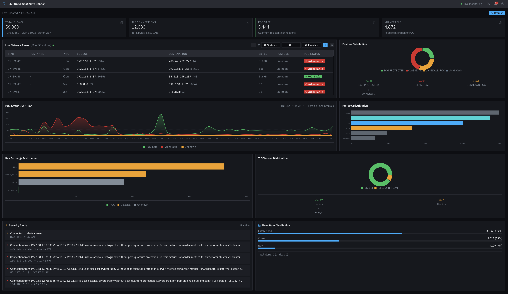
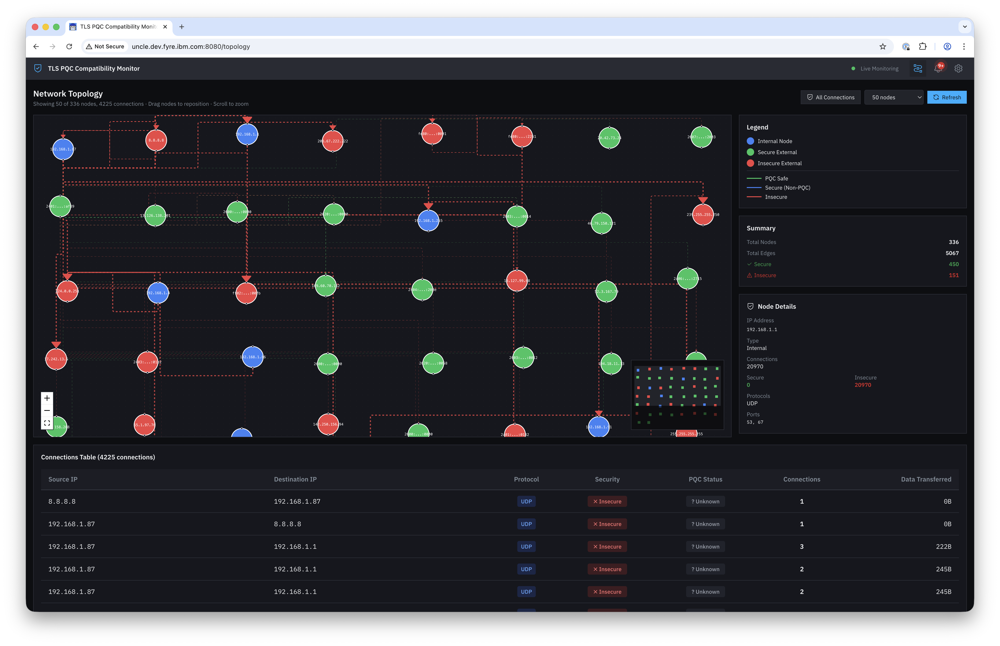
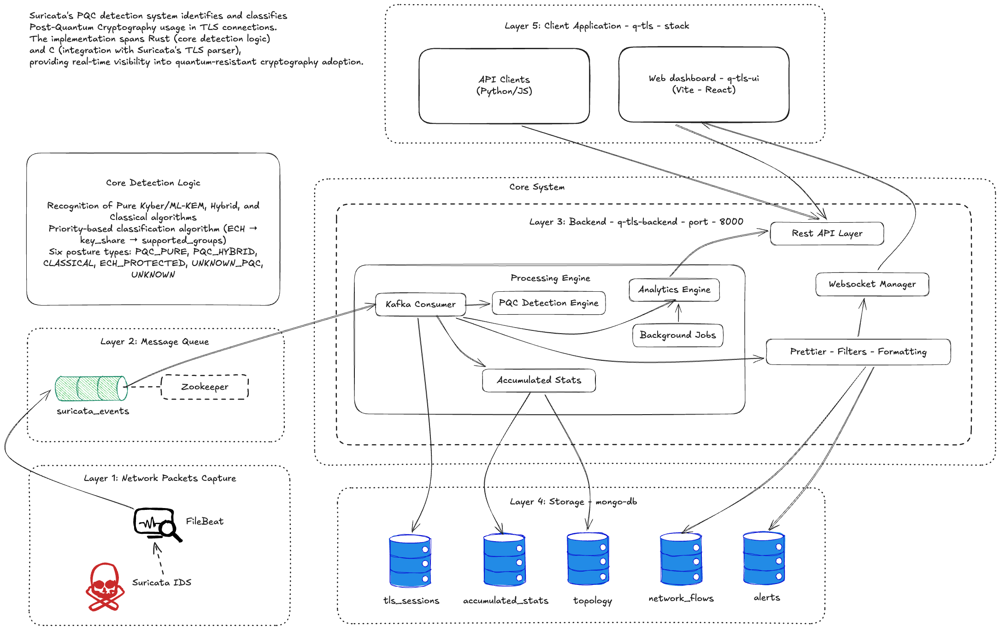
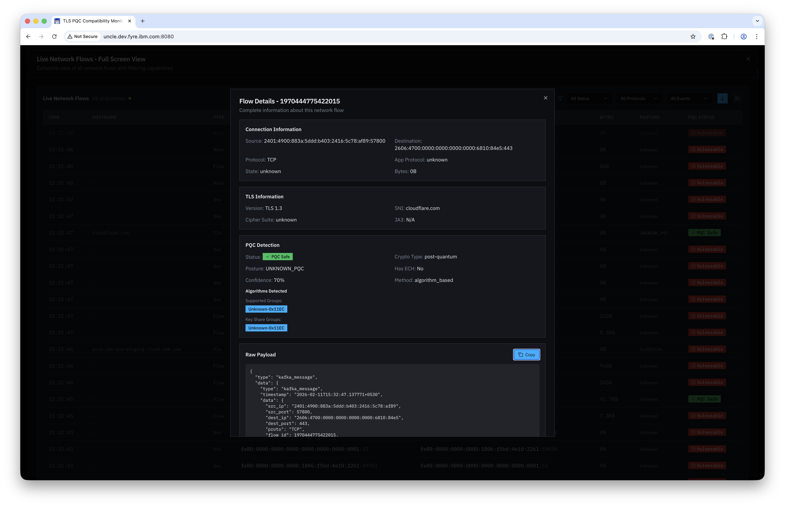

# Post-Quantum Cryptography Guard

A real-time network security platform that detects, classifies, and visualizes **post-quantum cryptographic (PQC) adoption** in live TLS 1.3 traffic — and lets operators interrogate that data in plain English through a built-in **LangGraph multi-agent AI system**.

The platform addresses the emerging quantum computing threat to today's encryption standards. It captures TLS handshakes at the network layer using a custom-modified Suricata IDS (C + Rust), streams events through Kafka, classifies each connection as `PQC_PURE`, `PQC_HYBRID`, or `CLASSICAL`, and stores results in MongoDB. A **LangGraph-orchestrated agent** — with a 6-node execution pipeline, Agent-to-Agent (A2A) protocol, and specialized PQC Expert and Security Analyst sub-agents — answers natural-language security queries grounded in live telemetry. A React/TypeScript dashboard renders real-time visualizations, network topology graphs, and an embedded AI chat interface.

---

## Architecture

```
┌─────────────────────────────────────────────────────────┐
│  Layer 1 — Network Capture                               │
│  Suricata IDS (C + Rust)                                 │
│  Custom PQC Rust module — parses TLS 1.3 ClientHello     │
│  Detects: ML-KEM, Kyber, Dilithium, SPHINCS+             │
│  Classifies: PQC_PURE / PQC_HYBRID / CLASSICAL           │
└───────────────────────┬─────────────────────────────────┘
                        │ EVE JSON  (pqc.* fields)
┌───────────────────────▼─────────────────────────────────┐
│  Layer 2 — Event Streaming                               │
│  Filebeat → Apache Kafka                                 │
│  Topic: suricata-events  (1000+ TLS events/sec)          │
└───────────────────────┬─────────────────────────────────┘
                        │
┌───────────────────────▼─────────────────────────────────┐
│  Layer 3 — Backend (FastAPI / Python)                    │
│  Kafka consumer → PQC classifier → REST & WebSocket APIs │
│                                                          │
│  ┌─────────────────────────────────────────────────┐    │
│  │  LangGraph Multi-Agent AI System                 │    │
│  │                                                  │    │
│  │  SecurityAnalystAgentRuntime (agent_runtime.py)  │    │
│  │  load_memory → plan → execute_tools →            │    │
│  │  verify → respond → finalize                     │    │
│  │                                                  │    │
│  │  OrchestratorAgent (LangGraph StateGraph)        │    │
│  │  router → [pqc_expert | security_analyst |       │    │
│  │           network_topology] → aggregator →       │    │
│  │           responder                              │    │
│  │                                                  │    │
│  │  A2A Protocol: AgentRegistry + AgentMessage      │    │
│  │  Providers: OpenAI / Anthropic / Ollama (local)  │    │
│  └─────────────────────────────────────────────────┘    │
└──────────┬───────────────────────┬──────────────────────┘
           │                       │
┌──────────▼─────────┐  ┌──────────▼──────────────────────┐
│  Layer 4 — Storage  │  │  Layer 5 — Frontend (React / TS) │
│  MongoDB            │  │  Real-time dashboard              │
│  Time-series +      │  │  Network topology (D3.js)         │
│  agent conversations│  │  Security alerts + AI chat        │
└────────────────────┘  └──────────────────────────────────┘
```

---

## Features

| Feature | Detail |
|---|---|
| **PQC Detection** | Classifies connections as `PQC_PURE`, `PQC_HYBRID`, or `CLASSICAL` using TLS extension parsing + byte-level heuristics (96% accuracy) |
| **Suricata Integration** | Custom Rust module + C FFI for TLS 1.3 ClientHello inspection; adds `pqc.*` fields to EVE JSON |
| **Kafka Streaming** | Filebeat ships Suricata events to Kafka; FastAPI consumer processes 1 000+ events/sec |
| **AI Analysis Agent** | LangGraph-based multi-agent system (6-node state machine) with Agent-to-Agent (A2A) protocol; orchestrates PQC Expert and Security Analyst agents |
| **Real-time Dashboard** | React + TypeScript with Recharts, D3.js network topology, WebSocket live updates (sub-second latency) |
| **Alert System** | Severity-classified alerts (critical/high/medium/low) with automated prioritisation |
| **Network Topology** | Visual graph of nodes classified by PQC posture across the monitored network segment |

---

## Technology Stack

**Backend:** Python, FastAPI, LangGraph, LangChain, Apache Kafka, MongoDB, WebSocket  
**Frontend:** React 18, TypeScript, Vite, Tailwind CSS, Recharts, D3.js, shadcn/ui  
**Network Layer:** Suricata IDS (C + Rust), Filebeat  
**AI / LLM:** LangGraph state machine, Ollama / Llama 3 (local), OpenAI-compatible interface  
**Infrastructure:** Docker, Docker Compose  

---

## Quick Start

### Prerequisites

- Docker & Docker Compose
- Python 3.11+
- Node.js 20+ (or Bun)
- Suricata (built from this repo — see [`suricata/INSTALLATION-GUIDE.md`](suricata/INSTALLATION-GUIDE.md))

### 1. Clone & configure

```bash
git clone https://github.com/your-username/Post-Quantum-Cryptography-Guard.git
cd Post-Quantum-Cryptography-Guard

cp backend/q-tls-backend/.env.sample backend/q-tls-backend/.env
# Edit .env — set KAFKA_BOOTSTRAP_SERVERS, MONGODB_URL, and optionally AGENT_OPENAI_API_KEY
```

### 2. Start infrastructure (Kafka + MongoDB)

```bash
cd backend/q-tls-backend
docker-compose up -d kafka mongodb
```

### 3. Start the backend

```bash
cd backend/q-tls-backend
python -m venv venv && source venv/bin/activate
pip install -r requirements.txt
uvicorn src.ngfw_pqc_detector.main:app --reload --port 8000
```

### 4. Start the frontend

```bash
cd frontend/q-tls-ui
npm install       # or: bun install
npm run dev       # opens at http://localhost:5173
```

### 5. Start Suricata with PQC detection

```bash
# See suricata/INSTALLATION-GUIDE.md for full build steps
sudo suricata -c /etc/suricata/suricata.yaml -i en0
```

---

## Repository Structure

```
├── backend/q-tls-backend/
│   ├── src/ngfw_pqc_detector/
│   │   ├── agents/          # LangGraph multi-agent system
│   │   ├── api/             # FastAPI routes + WebSocket
│   │   ├── core/            # Configuration (Settings)
│   │   ├── models/          # Pydantic data models
│   │   ├── services/        # Kafka consumer, PQC detector, analytics
│   │   └── main.py          # Application entry point
│   ├── tests/
│   ├── scripts/             # Utility & testing scripts
│   ├── docs/                # Technical deep-dives
│   └── docker-compose.yml
├── frontend/q-tls-ui/
│   └── src/                 # React + TypeScript source
├── suricata/                # Suricata fork with custom PQC module
│   ├── src/                 # C source — TLS parsing extensions
│   ├── rust/                # Rust PQC detection crate
│   └── rules/               # Suricata detection rules
└── images/                  # Architecture diagrams / screenshots
```

---

## How PQC Detection Works

1. **Suricata** captures TLS 1.3 ClientHello packets via `libpcap`.
2. The custom **Rust module** (`rust/src/detect/pqc*.rs`) inspects the `supported_groups` and `key_share` TLS extensions.
3. Group codes are matched against known PQC identifiers (ML-KEM-768 `0x11ec`, Kyber-level values, X25519Kyber768, etc.).
4. A connection is classified:
   - **PQC_PURE** — only PQC key exchange groups
   - **PQC_HYBRID** — PQC + classical groups (e.g. X25519 + ML-KEM)
   - **CLASSICAL** — no PQC groups detected
5. The classification + raw group IDs are emitted as `pqc.*` fields in Suricata EVE JSON.
6. The **FastAPI backend** consumes these events from Kafka, stores them in MongoDB, and pushes live updates to the dashboard over WebSocket.
7. The **LangGraph AI agent** can answer natural-language questions about the security posture, citing live data from MongoDB.

---

## Multi-Agent AI System

The agent system is the most technically interesting part of this project. It is fully implemented across these files:

```
src/ngfw_pqc_detector/
├── agent_runtime.py              # Core runtime — provider-agnostic, node-based execution
├── agent_graph.py                # Backward-compatible alias for the runtime
├── agent_models.py               # Pydantic request/response models
├── prompts/prompt.yaml           # System prompts for planner and responder nodes
└── agents/
    ├── orchestrator.py           # LangGraph OrchestratorAgent (StateGraph, 6 nodes)
    ├── protocol/
    │   ├── a2a.py                # Agent-to-Agent protocol (AgentRegistry, AgentMessage)
    │   └── base_agent.py         # BaseAgent class with capability registration
    └── specialized/
        ├── pqc_agent.py          # PQCExpertAgent — queries live stats from MongoDB
        └── security_agent.py     # SecurityAnalystAgent — analyzes alerts + threats
```

### How the agent works end-to-end

A user types a natural-language question into the dashboard chat (e.g. *"How many quantum-vulnerable connections in the last hour?"*). The request hits `POST /api/v1/agent/query` and flows through six explicit nodes:

```
load_memory → plan → execute_tools → verify → respond → finalize
```

| Node | What it does |
|---|---|
| `load_memory` | Loads conversation history from MongoDB (TTL-gated, falls back to in-memory) |
| `plan` | Calls the LLM with a list of available telemetry tools; LLM returns a JSON plan selecting which tools to invoke and with what arguments. If the query is ambiguous it returns `clarification_needed` instead. |
| `execute_tools` | Runs the selected tools against live MongoDB data (connections, alerts, topology, accumulated counters) |
| `verify` | Checks that every planned tool returned a non-null result — **blocks the response if the answer is not grounded in real telemetry** |
| `respond` | Calls the LLM again with the tool results to generate a human-readable answer |
| `finalize` | Assembles the `SecurityAnalystAgentResponse` (answer, confidence score, risk level, evidence list, full trace) and saves the turn to memory |

### LangGraph Orchestrator

[`agents/orchestrator.py`](backend/q-tls-backend/src/ngfw_pqc_detector/agents/orchestrator.py) builds a separate `StateGraph` that routes queries to one or more specialized agents over the **A2A protocol**:

```
router → security_analyst ──┐
       → network_topology ──┼→ aggregator → responder → END
       → pqc_expert ────────┘
```

The router inspects the query for keywords (`alert`, `topology`, `quantum`, etc.) and selects the right agents. The aggregator computes a confidence score from the ratio of successful agent responses. The responder synthesizes a final answer with the LLM.

### A2A Protocol

[`agents/protocol/a2a.py`](backend/q-tls-backend/src/ngfw_pqc_detector/agents/protocol/a2a.py) implements a lightweight inter-agent messaging layer:

- **`AgentRegistry`** — agents register themselves with their capabilities; others discover them by type or capability name
- **`AgentMessage`** — typed envelope (`REQUEST`, `RESPONSE`, `BROADCAST`, `NOTIFICATION`) with correlation IDs for request-response pairing
- **`MessagePriority`** — four-level priority queue (`LOW` → `CRITICAL`)

### LLM Providers

The runtime supports three providers, selected by the `AGENT_PROVIDER` env var:

| Provider | Class | Notes |
|---|---|---|
| `openai` | `OpenAIProvider` | Calls `api.openai.com`; supports JSON response format |
| `anthropic` | `AnthropicProvider` | Calls `api.anthropic.com` v1 messages API |
| `local` | `LocalLLMProvider` | Calls any Ollama-compatible server at `AGENT_LOCAL_BASE_URL` |

If no provider is configured the `DisabledProvider` raises a clear error rather than hallucinating.

### Agent API endpoint

```
POST /api/v1/agent/query
Content-Type: application/json

{
  "query": "What is the current PQC adoption rate?",
  "conversation_id": "optional-uuid-for-multi-turn",
  "time_window_minutes": 60,
  "limit": 20
}
```

Response includes `answer`, `confidence`, `risk_level` (`low`/`medium`/`high`/`critical`), `evidence` (list of tool results used), and a full `trace` of every node execution.

---

## Screenshots

| Dashboard | Network Topology |
|---|---|
|  |  |

| Architecture | Flow Details |
|---|---|
|  |  |

---

## Configuration Reference

Key environment variables in [`backend/q-tls-backend/.env.sample`](backend/q-tls-backend/.env.sample):

| Variable | Default | Description |
|---|---|---|
| `KAFKA_BOOTSTRAP_SERVERS` | `localhost:9092` | Kafka broker address |
| `MONGODB_URL` | `mongodb://localhost:27017` | MongoDB connection string |
| `AGENT_ENABLED` | `true` | Enable LangGraph AI agent |
| `AGENT_PROVIDER` | `openai` | LLM provider (`openai`, `anthropic`, `local`) |
| `AGENT_MODEL` | `gpt-4o-mini` | Model to use for agent responses |
| `AGENT_LOCAL_BASE_URL` | `http://localhost:11434` | Ollama base URL (for local LLMs) |

---

## License

Suricata is licensed under the [GNU GPL v2](suricata/LICENSE). Custom PQC additions and all other code in this repository are released under the MIT License — see [`LICENSE`](LICENSE) for details.
